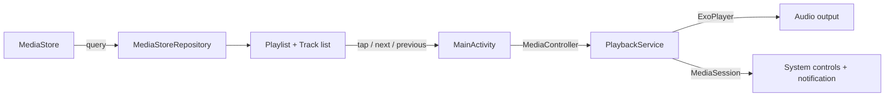

# Media Player

Your music, on your device, playing in the background.

Media Player lists the audio files already on your Android device and plays
them through a background service, so the music keeps going when you switch
apps or lock the screen, with controls in the notification shade, on the
lock screen, and on headsets and Bluetooth devices.

## What it does

- Lists local music from MediaStore, sorted by title, with artist and duration.
- Play, pause, previous, next, and seek, from the app or the system media controls.
- Background playback: the player lives in a Media3 `MediaSessionService`,
  not in the activity, so leaving the app does not stop the music.
- Pauses when headphones are unplugged and respects audio focus (calls and
  other media take over, as they should).

## Non-goals

- No streaming, no accounts, no cloud library. Local files only.
- No video UI in this version. The player core is ExoPlayer, so video is a
  UI decision for later, not a rewrite.
- No equalizer, playlists-as-files, or metadata editing. The list is your
  device's music library, as MediaStore sees it.

## Quick start

Prerequisites: Android Studio, JDK 17, and Android SDK 36 installed.

```bash
./gradlew assembleDebug
```

Then install the debug APK on a device or emulator from
`app/build/outputs/apk/debug/`, or press Run in Android Studio. Grant the
audio permission when asked; without it the track list is empty by design
(the query returns no rows, rather than failing).

Run the unit tests:

```bash
./gradlew testDebugUnitTest
```

## How it works



- `MainActivity` is the only screen. It never creates a player; it talks
  to the service through a `MediaController` connected in `onStart` and
  released in `onStop`.
- `PlaybackService` extends Media3's `MediaSessionService` and owns the
  single ExoPlayer instance. Media3 posts and updates the foreground-service
  notification for it.
- `Playlist` holds the track order and the selected index, with no wrapping
  at either end. It is free of Android types so its navigation rules are
  covered by plain JVM unit tests.
- `Track.toMediaItem()` is the one place that touches `Uri.parse`, so it is
  intentionally not unit-tested on the JVM (framework stubs throw there);
  it is exercised on-device through the activity.

## Permissions

| Permission | Why |
| --- | --- |
| `READ_MEDIA_AUDIO` (Android 13+) / `READ_EXTERNAL_STORAGE` (Android 12 and below) | List local audio files via MediaStore. |
| `FOREGROUND_SERVICE` + `FOREGROUND_SERVICE_MEDIA_PLAYBACK` | Run background playback as a foreground service (required on Android 14+). |
| `POST_NOTIFICATIONS` (Android 13+) | Show the media notification. Playback works without it. |

## Project layout

- `app/src/main/java/com/enonymous1/mediaplayer/` — `MainActivity`,
  `PlaybackService`, `MediaStoreRepository`, `Playlist`, `Track`,
  `TrackAdapter`.
- `app/src/main/res/layout/` — `activity_main.xml` (now-playing + controls
  + track list), `item_track.xml`.
- `gradle/libs.versions.toml` — every dependency and plugin version in one place.
- `.github/workflows/android.yml` — CI: unit tests + debug APK build.

## Toolchain

AGP 8.13.0, Gradle 8.14.3, Kotlin 2.3.0, compile/target SDK 36, min SDK 24,
Java 17, AndroidX Media3 1.7.1. Versions are pinned in
`gradle/libs.versions.toml`; bumping Media3 or the AndroidX libraries there
is the whole upgrade, since all Media3 modules share one version.

## History

The 2023 original was an untouched Android Studio template: a
"Hello World!" screen and no playback code at all. Version 2.0.0 is the
first functional release; see [CHANGELOG.md](CHANGELOG.md).

## License

MIT. See [LICENSE](LICENSE).
